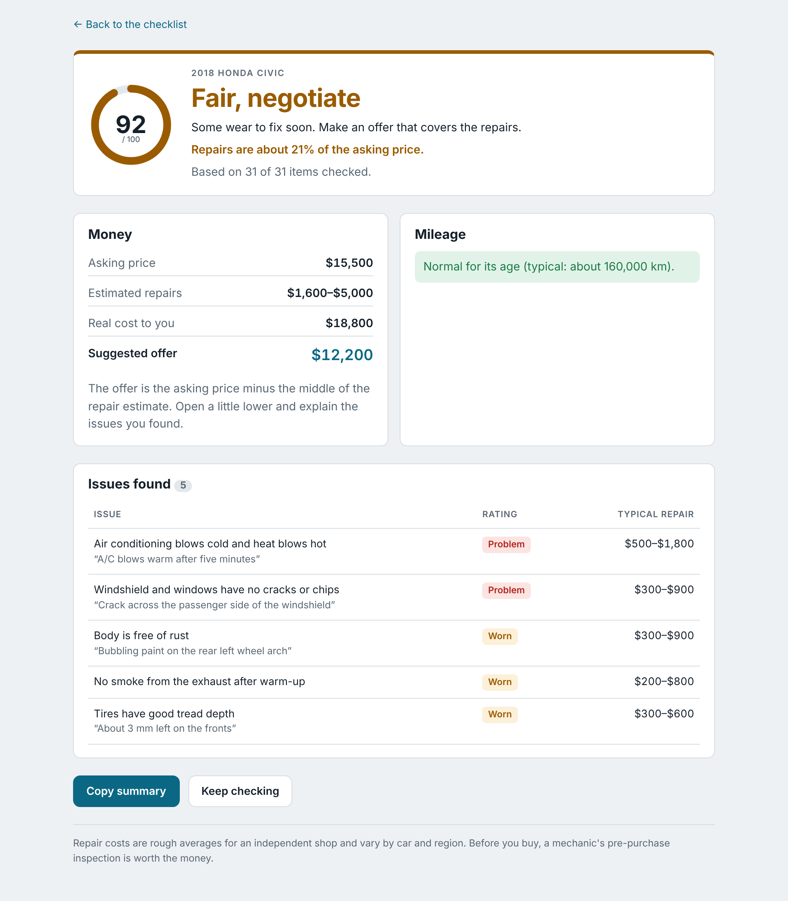

# lemoncheck

A used car inspection assistant for your phone. It walks you around the car with a checklist of what to look for and how to check it. Then it scores the car's condition, flags deal-breakers, estimates what the problems will cost to fix, and suggests an offer that accounts for them.

[Open Lemoncheck on Vercel](https://lemoncheck-red.vercel.app/) and select **Try sample cars** to explore three fictional inspections.



## The problem

Buying a used car is one of the largest purchases most people make, and most buyers don't know what to check. They miss rust, leaks, worn tires or a slipping transmission, find out after paying, and have no way to turn what they saw into a fair price. lemoncheck gives them a structured inspection and turns the results into numbers they can negotiate with.

## Who it's for

Private buyers looking at a used car from a dealer or a private seller, with no mechanic on hand. It's meant to be used on a phone, standing next to the car.

## What it does

- **Guided checklist:** 31 checks in six sections (paperwork, exterior, tires and brakes, under the hood, interior, test drive), each with a "How to check" tip.
- **Follow-up questions:** some answers open more checks. Rust on the body asks about the frame; smoke from the exhaust asks what colour it is.
- **Four ratings:** Good, Worn, Problem, or Can't check (which doesn't count against the car).
- **Condition score** from 0 to 100, weighted by how much each item matters.
- **Verdict:** Good buy, Fair, Risky, Avoid, or **Walk away** when a deal-breaker fails (salvage title, frame rot, flood damage, a slipping transmission, a head gasket). The verdict is capped when a major item fails or when repairs exceed 15% or 30% of the asking price, and the report says why.
- **Repair estimate:** a typical cost range for each issue, and the total.
- **Suggested offer:** the asking price minus the middle of the repair estimate, rounded down to $50.
- **Mileage check:** flags odometer readings that are high or suspiciously low for the car's age.
- **Compare cars:** ranks every car you've inspected by real cost (price plus repairs), with deal-breakers last.
- **Copy summary:** a plain-text summary to send to someone or keep in your notes.
- **Try sample cars:** loads three made-up cars (one to negotiate on, one clean, one with a deal-breaker) so you can see a report and a comparison without inspecting anything.

## Privacy

lemoncheck stores the car's make, model, year, odometer reading and asking price, plus your ratings and notes. There are **no fields for people**: no seller name, phone number, address, VIN or licence plate. Everything is saved in your browser's local storage on that device. There is no server, no account, and nothing is sent anywhere.

## Run it

Requires Node.js 20 or newer.

```bash
git clone https://github.com/Ibom1/lemoncheck.git
cd lemoncheck
npm ci             # installs the exact versions in package-lock.json
npm run dev        # open the printed address, or use your phone on the same Wi-Fi with --host
npm test           # unit tests for the checklist, scoring and storage
npm run build      # type-check and build the production site into dist/
```

## Built with

React 18, TypeScript, Vite and Vitest. No other runtime dependencies, no UI library and no router library.

## How it works

The interesting logic lives in `src/engine/` and has no React in it, so it is tested directly:

| File | What it does |
|---|---|
| `src/data/checklist.ts` | The checklist: sections, items, weights, repair cost ranges, deal-breakers and follow-up rules |
| `src/engine/checklist.ts` | Works out which items are visible (follow-ups appear and disappear with their trigger) and progress per section |
| `src/engine/assess.ts` | Score, verdict and its caps, repair estimate, suggested offer, mileage check, ranking, text summary |
| `src/data/demo.ts` | The three made-up cars behind "Try sample cars" |
| `src/engine/storage.ts` | Saves to and loads from localStorage, defensively: corrupted, old or blocked storage never crashes the app |
| `src/pages/` | Home, car details form, checklist, report, compare |

**Scoring.** Each rated item has a weight from 1 to 5. Worn costs 40% of the weight and Problem costs 100%; the score is the share of weight kept. Items marked "Can't check" are left out entirely, and an answer to a follow-up stops counting if its trigger changes.

**Why the verdict is capped.** Averaging 31 items lets two expensive problems hide behind 29 good ones. A score of 92 with $3,300 of repairs on a $15,500 car isn't a "good buy", so the verdict also looks at the worst single fault and at repairs as a share of the price.

**Repair costs** are rough parts-and-labour ranges for an independent shop. They size a problem and anchor a negotiation; they are not quotes.

## Limitations

- Repair costs are one set of averages for all cars and regions.
- It doesn't replace a mechanic's pre-purchase inspection, and the app says so on every report.

## License

[MIT](LICENSE)
